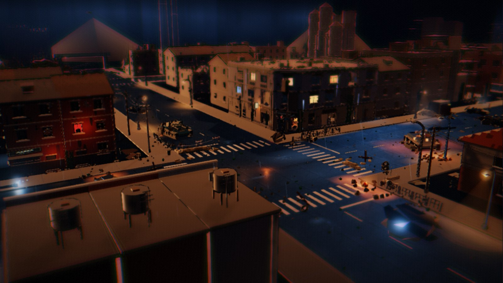
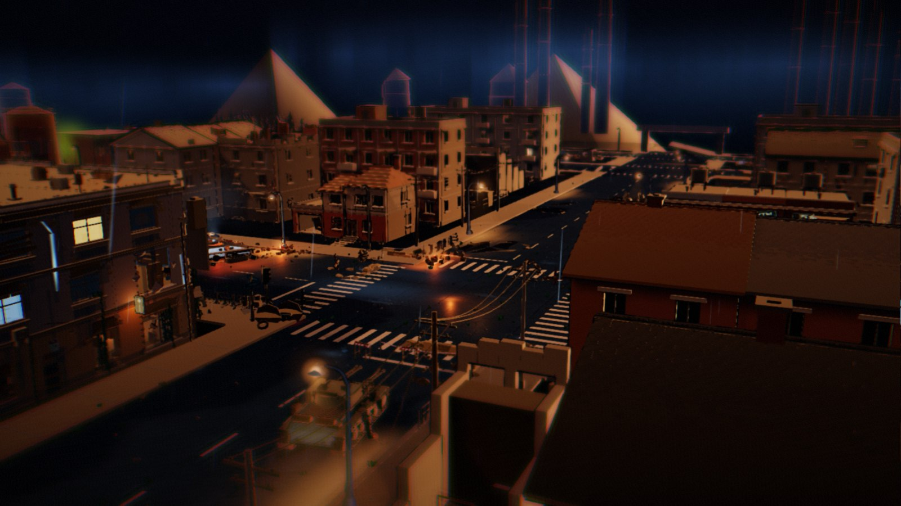
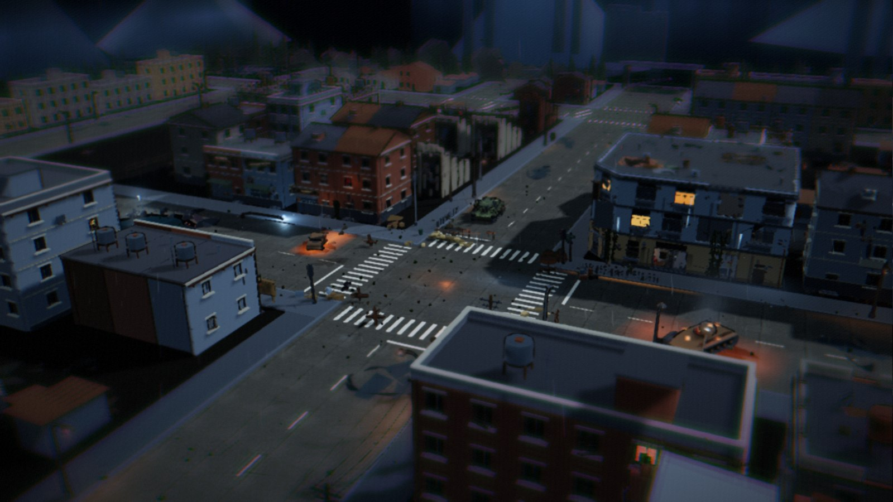
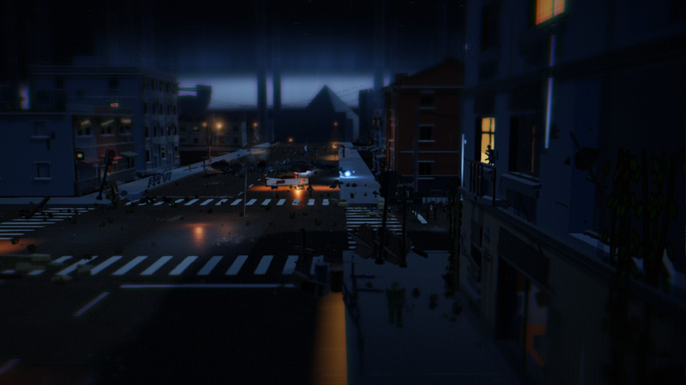
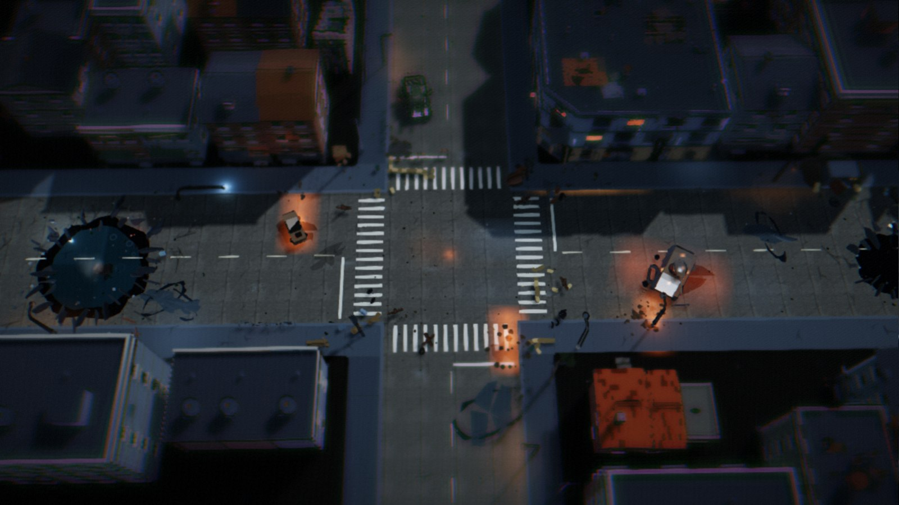

# 街角微缩景观（Street Diorama）

一个**可以自由拖拽、旋转、缩放观看的三维微缩景观**：东欧战场城市街角的三层小楼 + 周边小镇，雨夜、硝烟、残存灯火与局部火光。全程序化生成（无任何外部模型/贴图/字体），**屏幕上没有任何 UI 元素**，整块场景像摆在展台上的收藏级模型。

本项目从《Iron Front（钢铁前线）》拆分而来，是一个**独立的 Three.js 工程**：自己的 `package.json`、`node_modules`、构建与测试，不依赖主项目的任何代码。

- 引擎：**Three.js**（WebGL，三渲二 + 后期）
- 语言：**TypeScript**（严格模式）
- 构建：**Vite**
- 美术与音效：**100% 程序化生成**（Canvas 贴图 + 几何建模），无外部资源文件、无网络请求


## 这是什么

一间跑在浏览器里的**桌面微缩模型**：144 × 144 m 的展台上摆着一座东欧战场城市的街角 —— 三层街角小楼、联排住宅、半塌的乡村别墅、炮塔被掀翻的 T-72、还亮着灯的窗、雨里拖着水桶的老人。你可以拖着它转、滚着它放大，也可以按 `V` 切到第一人称走进去。

所有内容都是**代码现场生成的**：仓库里没有模型文件、没有贴图文件、没有字体文件，运行时不发任何网络请求。改一个常量，街上就多一栋楼、或者少一堵墙。

## 截图

下面全部是项目自己渲染出来的实际画面（`npm run shot` 出图），不是概念图：

| | |
|---|---|
|  |  |
| **雨夜街角** · 路灯的硬边阴影、湿路面积水反光、几扇还亮着的窗 | **黄昏** · 太阳压到街口，体积光从屋顶之间斜插下来 |
|  |  |
| **全景** · 内外两圈共 36 个地块，越远细节越自动降档 | **街面** · 斑马线、反坦克拒马、被击毁的载具与散落弹壳 |
|  | |
| **路口俯视** · 弹坑、瓦砾、临时路障与警戒带 | |

## 亮点

| 方面 | 做了什么 |
|---|---|
| **全程序化** | 建筑、街道、道具、人物、载具、雨幕、烟柱、火光、天空、贴图全部由 TypeScript 现场生成，零美术资源 |
| **两种相机** | 轨道俯瞰（拖拽旋转 / 滚轮缩放 / 右键平移 / 静置 12 秒自动环绕）+ 第一人称漫游（`V` 切换，`WASD` 走动） |
| **昼夜循环** | 深夜 → 拂晓 → 正午 → 黄昏平滑插值，人造光、雾、积水反射、天空与云跟着一起变 |
| **真光照** | 太阳/月亮主光 + 4 池轮换的路灯 + 局部火光与照明弹，用的是真阴影与 PCF，而不是把泛光贴满全屏 |
| **可验收** | Vitest 单测（随机源可复现、地块不重叠）+ Puppeteer 截图/交互/占位审计脚本，`npm run verify` 一把梭 |
| **零 UI** | 屏幕上没有按钮也没有文字，进度条淡出之后只剩画面本身 |

## 目录

- [1. 快速开始](#1-快速开始)
- [2. 操作](#2-操作)
- [3. 场景构成](#3-场景构成)
- [4. 项目结构](#4-项目结构)
- [5. 美术与渲染](#5-美术与渲染)
- [6. 动效清单](#6-动效清单)
- [7. 验收与调参工具](#7-验收与调参工具)
- [8. 已知取舍](#8-已知取舍)
- [9. 版权与素材说明](#9-版权与素材说明)
- [10. 昼夜循环](#10-昼夜循环daynight-cycle)
- [11. 288 m 扩建之后的新增动效](#11-新增动效清单288-m-扩建之后)
- [12. 双视角](#12-双视角自由俯瞰--第一人称)
- [13. 全局光照](#13-全局光照压暗的深夜--局部物理照明)
- [14. 游戏原型《过街》](#14-游戏原型过街m3a小队三人--回合制--声源)
- [15. 许可与使用](#15-许可与使用)

---

## 1. 快速开始
## 1. 快速开始

````bash
cd diorama
npm install
npm run dev          # http://127.0.0.1:4175/
````

### 一键启动（Windows）

双击本目录的 **`启动微缩景观.bat`**。脚本会检查本地服务是否在跑，没跑就以隐藏窗口拉起 `vite`（端口 **4175**），就绪后自动打开浏览器。日志在 `tools/launch-diorama.log`。

### 其它命令

````bash
npm run build        # 类型检查 + 生产构建 → dist/index.html
npm run preview      # 预览生产构建（http://127.0.0.1:4175/）
npm test             # 逻辑单元测试（随机源可复现 + 总平面不重叠/不越界）
npm run test:e2e     # 端到端画面验收（需先 npm run dev）
npm run verify       # typecheck + test + build
````

E2E 用 `puppeteer-core` 驱动**本机已安装的 Chrome**（不下载浏览器）。Chrome 不在默认路径时用环境变量指定：

````bash
# Windows PowerShell
$env:CHROME_PATH="D:\path\to\chrome.exe"
$env:DIORAMA_URL="http://127.0.0.1:4175/"
npm run test:e2e
````

---

## 2. 操作

| 操作 | 说明 |
|---|---|
| 左键拖拽 | 环绕旋转（阻尼平滑） |
| 滚轮 / 双指 | 缩放（14 m 近景 ~ 210 m 全景） |
| 右键拖拽 | 平移视点（限制在底座范围内） |
| 静置 12 秒 | 自动极缓慢环绕（一有交互立即停止） |
| 鼠标移到画面底边 / 按 `H` | 浮现**时间滑条**（默认不可见，见第 10 节） |
| 按 `V` | **切换视角**：自由俯瞰 ↔ 第一人称漫游（见第 12 节） |
| 第一人称：鼠标点击锁定 / `WASD` 移动 / `Shift` 快走 / `V` 返回 | |

相机为第三人称轨道视角，仰角限制在地平线以上，避免穿到模型下方。

---

## 3. 场景构成

底座是 **144 × 144 m 的正方形展台**（下方 6 m 厚压边），中央十字路口：东西向大道（宽 18 m）× 南北向纵街（宽 16 m），人行道 4 m、路缘 0.22 m。**内外两圈共 36 个地块**（内圈 15 + 外圈 13 + 补位 8，覆盖率约 41%），全部沿街排布、留出人行道，没有任何地块压在车行道或人行道上：内圈 15 块是主城区，外圈 14 块是郊区（联排/公寓/废墟/院子），越远细节越自动降档。

| 区域 | 内容 |
|---|---|
| 主楼（路口东北角，视觉中心） | 22 × 21 m 三层东欧/苏联式街角住宅 + 底商，西南街角切 3.6 m 转角门面；底层 4.3 m、二三层 3.3 m，檐口 10.9 m、女儿墙 ≈ 11.3 m。墙体是**真开洞**（洞穿透 0.55 m 墙厚，可见窗洞侧壁与断面），楼板是**真楼板**（带塌落洞与断面），三层室内都有陈设（商铺灶台、后厨残骸、楼梯间、储藏与地下室入口、二层前室/后室、三层避难角） |
| 周边小镇 | 15 个地块、共 15 栋程序化建筑：联排住宅、4 层板式公寓、两层商铺、铁皮车库/柴棚、半塌窄楼、带菜地与晾衣绳的院子 |
| 街角道具 | 路牌、6 根电线杆 + 下垂/断裂电线、2 组信号灯、沙袋掩体、5 个反坦克拒马、轮胎路障、护栏、公告栏、临时路障与警戒带、垃圾桶/木箱/油桶/推车，以及成簇的瓦砾与弹壳。路灯已升级成全图程序化系统（见第 5 节） |
| 载具 | 休息中的 BMPT（4 管 30 mm 机炮 + 2×2 导弹筒 + 3 名乘员）、被击毁的 T-72（炮塔掀偏、履带断裂、车体烧穿、余烬明灭）、烧毁的民用轿车、半空缓慢盘旋的侦查无人机 |
| 居民 | 商铺内做饭的主妇（炉火 + 蒸汽）、拉着两轮拖车与水桶的老妇人、在人行道上玩石子的两个小孩 |
| **定制乡村别墅**（**临大道南侧，独栋**） | `world/villa.ts` · `createCustomVilla(ctx, HOTSPOTS.villa)`。位置 `(22, 16.5)`、朝向 `rotation=π` —— **正面（车库大豁口 + 正门）朝北面向主干道**，后排公寓被推到 z≥28，让别墅拥有独立的临街街区与呼吸空间。<br>**结构**：左侧单层平顶车库 + 右侧两层坡顶主楼（非对称）。车库正面完全敞开、**两根承重柱**（剥落混凝土）撑起平顶、**半卡住的卷帘门**（垂下的条纹门板卡在半空、门框有厚度、轨道生锈、门楣上堆着碎砖）、左墙大面坍塌只留残根 + 外露扭曲钢筋 + 墙脚砖堆；内部有翻倒的椅子、柜子、瓦砾，敞口内侧挂**闪烁的暖色应急灯**。<br>**主楼**：方形基座 + 二层退台 + **红瓦坡屋顶** —— 瓦片按**瓦垄逐行搭接**（看得出错缝与叠放顺序），缺瓦处露出**焦黑木梁与椽子**，屋顶缝隙里长着杂草；烟囱是**分层砖砌**（带灰缝、熏黑、破边、歪铁帽）；墙脚 1 m 红砖墙基、其上斑驳灰白抹灰（剥落斑块 / 弹孔凹坑 / 雨水冲刷的竖向污渍 / 锯齿状碎玻璃 / 倾斜外翻的木百叶）；正门 3 级混凝土台阶 + 半脱落的双开木门 + 破损雨棚。<br>**生活痕迹**：二楼窗外晾衣绳挂着 3 件破旧衣物（随风飘动）、门口堆着歪斜木箱与生锈油桶、门廊平顶有积水反光。<br>**光影**：门前一盏**街灯**（SpotLight + 阴影）自上而下照亮立面，打出硬边卡通阴影与边缘光；红屋顶与门廊平顶都会**溅射雨滴**。 |

---

## 4. 项目结构

````
diorama/
├── index.html           页面骨架（只有画布，无 UI）
├── package.json
├── tsconfig.json
├── vite.config.ts       端口 4175、three 分包
├── vitest.config.ts
├── 启动微缩景观.bat      Windows 一键启动
├── docs/
│   └── HIGH_FIDELITY.md 高保真建模规范（"细节语言"）
├── src/
│   ├── main.ts          渲染器 / 相机 / 后期 / 主循环（无 UI）
│   ├── scene.ts         光照、雾、背景、模块装配
│   ├── core/
│   │   ├── rng.ts       可复现随机源（mulberry32 + fork）
│   │   ├── palette.ts   三渲二雨夜色板（冷灰蓝 + 暖橙火光）
│   │   ├── materials.ts 卡通材质工厂、程序化 Canvas 贴图、反向外扩描边
│   │   ├── geo.ts       几何/摆放工具、顶点噪声、合批、实例化
│   │   ├── camera.ts    轨道相机（阻尼 / 自动环绕 / 视点约束）
│   │   ├── post.ts      泛光 → 移轴虚化 → 冷调分级 + 暗角 + 颗粒
│   │   ├── context.ts   BuildContext（随机源 / 时间驱动 / 灯光预算）
│   │   ├── ticker.ts    时间驱动（统一推进所有动效）
│   │   └── detail.ts    高保真细节构件（遵循 docs/HIGH_FIDELITY.md）
│   ├── world/
│   │   ├── layout.ts    总平面：底座、道路、主楼、地块、巷道、关键点位
│   │   ├── base.ts      展台底座、路面、标线、积水、弹坑、收边瓦砾
│   │   ├── hero.ts      主楼（真开洞墙体 / 真楼板 / 三层室内陈设）
│   │   ├── town.ts      周边 15 栋小镇建筑
│   │   ├── props.ts     街角道具与街道设施
│   │   ├── streetlightPlan.ts 全图路灯落位（间距 / 路口净空 / 20% 损坏配额）
│   │   ├── streetlights.ts    路灯实例化资产、动态灯池、光柱、湿地反光、短路火花
│   │   ├── vehicles.ts  BMPT + 乘员、被毁 T-72、烧毁轿车
│   │   ├── people.ts    主妇、老妇人、两个小孩
│   │   ├── patrol.ts    巡逻士兵
│   │   ├── drone.ts     盘旋的侦查无人机
│   │   ├── convoy.ts    行进军车队（坦克/步战车/卡车 + 士兵，沿道路循环驶入驶出）
│   │   ├── extras.ts    巷口松脱铁皮与旧药房灯箱（摆动 + 老灯管闪烁）
│   │   └── _props_hi.ts 高保真生活道具的另一版实现（当前未被 scene 引用）
│   └── fx/
│       ├── rain.ts      雨幕、落地溅射、积水涟漪、檐滴、破窗水痕
│       ├── smoke.ts     T-72 余烬与烟柱、远处硝烟、做饭蒸汽、小火苗、贴地薄雾
│       └── spill.ts     光源在地面上的湿反光条
├── tests/
│   ├── diorama.test.ts  随机源可复现 + 总平面校验
│   └── e2e/
│       └── diorama-check.mjs   端到端画面验收 + 4 机位出图
└── tools/               24 个调参与审计脚本（见第 7 节）
````

---

## 5. 美术与渲染

- **三渲二**：`MeshToonMaterial` + 3 阶级阶梯渐变贴图（暗部抬到 0.42 以保留雨夜层次），大面积色块、干净轮廓。
- **描边**：反向外扩壳（BackSide + 屏幕空间恒定粗细），只给体块 / 载具 / 人物这类"剪影重要"的对象，避免碎件噪点。
- **光照**：冷月光平行光（2048 阴影）+ 天光半球光 + 反向冷补光；室内暖光、炉火、余烬、灯箱等既有局部光共 20 盏。全图路灯另有一组 4 盏动态灯池（3 盏 1024 阴影 SpotLight + 1 盏补光），按视线焦点贴近相机；`MAX_POINT_LIGHTS = 24`，同位置光源自动去重。
- **后期**：UnrealBloom（火光 / 灯箱泛光）→ 移轴虚化（强化"微缩模型"观感）→ 冷调分级 + 暗角 + 极细胶片颗粒 + 边缘轻微色散。
- **湿路面**：PBR 沥青（`roughnessMap`）+ 低粗糙度积水 + 雨滴涟漪/溅射；路灯、火光、橱窗各自在地面拉出加色反光条，路灯反光按 76 个真实灯位实例化生成。

### 高保真建模规范

全部资产遵循 `docs/HIGH_FIDELITY.md` 的"细节语言"，目标是**精致的 3D 拼装模型**（田宫 / 万代高达模型、高品质动画电影场景），而不是照片级写实：

- **几何优先**：结构感来自真实建模的体块、凹凸、厚度，而不是贴图。门窗有洞口侧壁与窗台进深；剥落墙皮是有厚度、边缘参差的破片并露出**错缝砖芯**；弹孔有崩裂碎屑环；破口内可见砖石断面与外露钢筋。
- **独立高模附件**：檐沟（带托架）、落水管（带接口环与弯头）、空调外机、屋顶检修口/通风帽/水箱/天线、女儿墙压顶、楼层腰线（带滴水斜面）都是独立资产。
- **车辆**：履带一节一节独立几何体（带驱动齿）；轮胎有人字胎纹；车门铰链/把手/车灯外罩/后视镜齐全；反应装甲块有立体厚度与崩角；炮口有退制器开孔；外挂杂物箱/天线/备用履带板极其丰富。
- **士兵**：头盔（帽檐+护耳+挂带）、有厚度的防弹背心、3 个弹匣袋、可辨识的枪械；姿态符合人体工学（坐/站/蹲三种休息姿态，关节有折角，不是"方块人"）。
- **生活道具**：拖车有轮轴结构与辐条轮；水桶有提手与凹痕；炉灶是砖砌（可见错缝）并带炉门铰链；晾晒衣物有褶皱轮廓。
- **路面**：沥青裂缝是凹进路面的**真实几何细槽**；井盖有下沉座圈、边缘齿圈与放射铸铁纹；积水有微微隆起的湿痕边缘、水底可见泥与碎石。

### 连排房的平顶化与外墙逃生梯

一批连排住宅（`layout.ts` 里标注「平顶联排」的地块）做了结构重构：

- **坡顶拆平顶**：`town.ts` 的 `flatRoofDamaged()` 接管屋顶生成 —— 屋面是平的（带泛水卷边、翘起的防水补丁），**女儿墙分段砌、留出缺口**，缺口处只剩 0.06–0.2 m 高的红砖残根并**露出外伸的钢筋**。
- **屋面不空荡**：水塔（铁皮罐 + 支腿 + 斜撑 + 两道箍 + 歪顶盖）、2–3 个高低不一的烟囱、通风管道与风帽、带横杆的天线、**废弃卫星锅**（抛物面 + 支臂 + 底座 + 接收头）、散落的旧木箱 / 铁桶 / 瓦砾。
- **外墙逃生梯**（Z 字形金属梯）：`town.ts` 的 `facadeFireEscape()`
  - 有一条贴墙的**竖向爬梯井**，每层平台**左右交替**挂在中线两侧 → 真正的 Z 字
  - 平台高对齐各层窗台（人能跨进窗）
  - **踏板是镂空格栅**（7 根细条 + 3 根联系条拼成网格，不是实心板）
  - 扶手有**粗细变化**：主扶手 0.07 / 中间横杆 0.038 / 立柱 0.05
  - 与墙的连接支架是两根**斜撑 + 底托**，有立体厚度
  - 材质独立（`escapeMetal` 冷调金属 / `escapeDark` 暗件 / `escapeRust` 锈斑），与砖墙明确区分，路灯下会反光
  - 战损：某几层踏板**缺失或下垂**、立柱弯折、栏杆断口、锈斑斑驳
- **窗户**：原有内退窗框 + 外挑窗台 + 碎玻璃残渣基础上，新增**半损毁的木质百叶 / 遮阳板**（歪斜外翻、投出细密条状影子）；坍塌阳台的栏板从亮白抹灰改为**断成几截的深色木板**。

**风格红线**：所有细节都在三渲二 + 清晰轮廓线的框架内完成；**只给剪影重要的体块描边**（碎屑/砖块/胎纹不描边，否则画面变脏、draw call 爆炸）；色彩只用冷灰蓝 + 暖橙两族，战损为去饱和锈褐 / 焦黑。

### 斑马线（重画）

- 白条长边**平行于行车方向**：横穿东西向大道时，白条是一根根东西向横档，人踩着一根根过街；旧实现的长边沿人行方向，读起来像顺着走路方向的导轨。
- 每条路在每个路口的两侧各一道；条带对齐被横穿道路的人行道中线（带宽取人行道净宽 2.6~4.2 m），白条 0.5 m、缝 0.7 m（GB 5768 量级），两端各留 0.8 m 不糊到路缘。四角补平后，人从人行道直着走上斑马线，不再被空洞逼着往外绕。
- 停止线只画在斑马线的**来车侧**，铺满来车方向那半幅车道；中心虚线在路口段连斑马线一起断开（断口只需让出对方人行道，不再额外让一条斑马线的宽度）。
- 标线改成做旧暖白 `0xb8b3a6`——换浅色沥青贴图后，旧值 `0x63605a` 比路面还暗，斑马线成了黑缺口。
- 验证：`node tools/zebra-iso.mjs` 只留标线做正交俯视；`python tools/zebra-orientation.py <shot> <crop>` 用连通域逐根测长边方向（实测东西向 0.0°、南北向 89.8°）。旧版脚本把所有白像素做一次 PCA，量到的是排列方向而不是单条方向，会正好读反。

### 路口四角

两条人行道在路口本来是 L 形相接，之前两边都在对方走廊处断开，四个角各留一块方形黑洞（斑马线也因此被迫外移）。现在每对相交道路在四个象限补一块 3.25~4.25 m 见方的转角板，配两段路缘：沿 x 向的那段盖住转角，沿 z 向的那段从它外侧接出去，避免两块石顶面重叠。丁字路口只在支路真正存在的那一侧补角，同时让过路的人行道只在有支路的一侧断开、对侧保持连续（`crossingSpansForSide`）。转角板和路缘都并进原有批次，不增加 draw call。

### 路口只保留一层路面

大道 × 纵街、四条环道相交处原本各铺一块**同高度**的 `PlaneGeometry`，深度值完全相等，镜头一动整个路口中心就闪 —— 换成真实沥青贴图后骨料细节把这种闪烁放大得尤其明显。现在按 `roadLayer`（等级 > 路幅宽 > 东西向）只让高层路面铺过路口，低层路面用 `subtract` 让开高层车行道后分段；UV 按段起点偏移，段与段之间的花纹保持连续。全图路面从 8 块变成 18 块，draw call 从 1416 升到 1420（仍有 1600 预算），换掉的是必现的深度闪烁。贴地焦痕同理保持水平：4.2 m 的圆片倾 0.02 rad 就会切进路面，沿交线闪出亮边。

### 全图路灯（含随机倒塌）

- **落位**（`world/streetlightPlan.ts`）：8 条道路两侧交替布灯，间距 18 m，灯杆压在人行道内缘（距路缘 0.85 m），灯臂伸向车行道；路口走廊、斑马线、停止线、铁路道口、信号灯/路牌/人物全部留净空。全图 **76 盏**。
- **资产**（`world/streetlights.ts`）：杆身/基座/弯臂/灯罩合并成一套几何，用 `InstancedMesh` 渲染；配一张同实例矩阵的反向外扩描边（`lamp-outline`，描边材质已支持 `instanceMatrix`）。灯面按完好/故障/熏黑分成三组实例，另有实例化光柱（`lamp-cones`）、地面反光（`lamp-spills`）、倒地碎石与 4 个短路火花小网格。实例化批次共 8 个，整套系统约 12 个 draw call，而不是 76 组。
- **损坏配额**：20%（15/76，先洗牌再取固定比例，避免独立抽样偏到 30%）。其中向车行道倾倒 46–66°、沿街侧倒 56–78°、完全平躺 90°。沿街侧倒而不是朝建筑倒，是因为人行道外侧紧贴临街立面，45° 以上必然穿墙；沿街倒同样读得出灾难感，且不穿模。
- **倒地姿态**：平躺灯绕灯臂方向转 90°，杆身沿人行道贴地，灯头落进路缘外的车行道；基座略埋、灯罩半埋，周围有碎石。实测 5 盏倒地灯的杆身最低点均为 0.222 m（人行道面 0.22 m），贴地不悬空；基座与灯罩按半埋处理，周围补碎石。倒地足迹先做 AABB 检查，压到车队车道就改成侧倾。
- **真实灯池**：3 盏带 1024 阴影的 `SpotLight` + 1 盏无阴影补光（`0xffaa55`、`decay = 2`、`distance` 13/11 m），按相机视线与地面的焦点动态分配给最近的路灯。倾斜灯的聚光方向沿灯头局部 -Y：实测 67° 倾斜灯的 target 在 10 m 外偏移 9.2 m，光斑斜打地面。倒地灯不参与灯池，个别灯头保留冷蓝/暗红短路火花；故障灯会让灯面、地面反光与（若被选中）SpotLight 一起通断。
- **阴影**：`lamp-poles.castShadow = true`、`instanceMatrix.needsUpdate = true`。阴影改为**按灯按需重烘**：灯池换位只重烘 3 盏路灯聚光，太阳/别墅灯由昼夜装置每 2 s 统一刷新；主循环里 `consumeStreetlightShadowDirty()` 触发一次全局 shadow pass，未标脏的灯自动跳过。这样不会因为一次换位把 2048 的太阳阴影图连同整座城重画。
- **验收**：`node tools/lamp-audit.mjs` 输出实例数、倒地杆身最低点、灯池分配与近景出图；单测覆盖落位 / 20% 比例 / 路口净空 / 车队车道。

---

## 6. 动效清单

| 类别 | 动效 |
|---|---|
| 天气 | 6800 条 GPU 循环雨丝（覆盖 168 m）、420 个落地溅射、38 个积水涟漪、14 处檐滴、5 处破窗水痕 |
| 湿反光 | 路灯/火光/橱窗/余烬正下方的**拉长反光条**（加色混合、随火光/故障灯轻微闪烁）；路灯反光按 76 个真实灯位生成，雨夜"灯在水里"的核心细节 |
| 火光 | T-72 余烬明灭（4–9 s 呼吸 + 偶发爆亮）、3 处小火苗跳动、炉火高频抖动 |
| 烟 | T-72 烟柱 20 团、四处远处硝烟、做饭蒸汽 26 团 + 门洞轻烟、贴地薄雾 |
| 灯光 | 全图 4 盏故障路灯不规则闪烁、倒地灯头冷蓝/暗红短路火花、信号灯缓慢变化、断落电线偶发火花、室内应急灯呼吸 |
| 物件 | 警戒带随风轻摆、倾倒垃圾桶被雨滴打到微抖、巷口铁皮被阵风掀起、旧药房灯箱缓慢摆动 + 老灯管接触不良闪烁、拖车与水桶缓慢钟摆、水面起伏 |
| 生物 | 乘员呼吸 + 10–20 s 转头、主妇搅拌与身体微晃、老妇人呼吸、两个小孩循环小动作 |
| 空中 | 无人机 78 s/圈盘旋（半径 17 m、高度 18 ± 0.4 m、机头朝切线、侧倾、红绿航灯短闪 + 柔光晕） |
| 车队 | **一支行进中的军车队**（主战坦克开路 + 步兵战车 ×2 + 篷布卡车 ×2，车顶/车斗有士兵）：沿纵街从北边界驶入、穿过十字路口、再从南边界驶出，循环往复；轮/履带滚动、车体颠簸、头车灯光晕在湿路面上移动、排气淡烟 |

### 性能

### 第一人称行走：把"空气墙"清掉（这一轮）

原来可行走域是"核心区 + 内圈带（|x|,|z| ≤ 90）"，更外圈只能走马路。三个扩建分区的建筑从来没有集中登记，
新加的建筑更不会有，于是分区里的巷子、院子一进去就撞墙。审计脚本在 0.5 m 网格上量化后，一次清掉四个来源：

| 来源 | 现象 | 改法 |
|---|---|---|
| `kind: 'yard'` 地块 | 20×14 m 的空院子被整块当实体，院中央凭空一堵墙 | 院子不再整块挡人，里面的棚子/围墙交给几何障碍 |
| 地块矩形 = 地皮而非楼体 | 楼只有 8~12 m 深，后半截后院被一起封死 | 按 `facing` 只挡"临街面往里的 12 m 楼体进深" |
| 地块是设计意图 ≠ 实际几何 | 有地块因为放不下/被占位拒绝而根本没建楼，整块空地仍被拦 | 建成后用一次性向下射线验证：地块内命中高度 > 1.35 m 才算真有楼 |
| 分区建筑没有集中登记 | 行走域只能在 ±90 收边，外面全是空气墙 | 从场景网格自动生成障碍（跨度 ≤26 m、高度 >1.35 m、非透明、非实例化），按 8 m 格索引；别墅/天空/远景等自带精确碰撞的模块跳过 |

顺带把设计巷道 `ALLEYS` 接进行走判定（它一直只在填充模块里用过，行走时仍被地块矩形吃掉）。

实测：可行走面积 **84405 → 109900 格（+30%）**；三条设计巷子被挡点数全部归零；
别墅可达性 10/10、交互与无 UI 检查仍全通过，帧率维持 48 fps。

### 加载条与"读完条之后的黑屏"


症状：进度条走到 100%、遮罩淡出后，屏幕还要黑 9~25 秒才出现画面。

分步计时定位（`[boot] 计时 …` 日志）：

| 阶段 | 耗时 | 说明 |
|---|---|---|
| `buildDiorama` | 2.4 s | 场景构建（进度条原本只反映这一段） |
| `createCamera` / `createPost` / 昼夜绑定 / 第一人称 / 碰撞 | 各 < 10 ms | 都是便宜操作 |
| `renderer.compile` | 0.1 s | 程序早就被缓存了，所以很快 |
| 首个 `post.render` | 15~25 s | **一次性上传全部贴图/几何 + 链接程序**（实测：缩到 320×180 仍要 20 s，说明与像素数无关） |
| 撤遮罩后等 rAF | 7~12 s | 首次把 WebGL 画布交给合成器 |

改法（结构性保证，不依赖具体耗时）：

1. **进度条只走 92%**：剩下 8% 留给"管线 + 编译 + 首帧"，条不会在还有活的时候显示完成。
2. **遮罩留到首帧真正上屏**：`post.render(0)` 之后等两次 rAF（一次绘制、一次提交合成器）才撤遮罩。
   截图核对：遮罩淡出那一刻城市灯光已经在画面里，不再有"黑屏窗"。
3. **卡住时让条继续动**：主线程被整段占住时百分比刷不出来，`loading.busy()` 把进度条切成
   `transform` 关键帧动画（合成器线程驱动，主线程卡死也不停），标签显示"首帧"。
4. **阴影烘焙挪出关键路径**：阴影 pass 与视口无关（太阳 2048² + 路灯池 4×512²），
   84 万面要重画五六遍；先出画面，遮罩淡出后再补阴影（夜里太阳本来不投影，观感几乎无差）。
5. **引导阶段不用 rAF 让步**：首次合成要 7~12 s，等 rAF 等于白等，改用宏任务让步。

> 本机是软件渲染，首帧那段固有成本约 20 s；真实 GPU 上是一次性的 1~2 s。
> 这次改的是"这段等待不可见、表现为黑屏"，不是把上传本身变快。

| 指标 | 数值（1600 × 900，本机实测） |
|---|---|
| 底座 | **288 × 288 m** 正方形展台，两级地台切面；核心 37 地块 + 内圈带 8 块 + 三个新分区（平民区 6 带 / 工业区 3 带 / 哨卡两翼）+ 三个边缘废墟带 |
| mesh 数 | **1560**（含三新区、远景剪影、体雾与路灯实例；静态描边壳合并后） |
| 三角面 | **84.8 万** |
| draw call | **约 1223**（静态描边由 248 条并成 110 条） |
| 帧时 | 默认远视角：中位 **20.8 ms（约 48 fps）**，p95 27.7 ms；优化前同机位 27.8 ms（36 fps） |
| 光源 | 38（3 平行光 + 1 半球光 + 30 点光 + 4 投影 Spot） |
| 抗锯齿 | FXAA（全帧）；默认帧缓冲的 MSAA 已关闭——合成走 composer，那层 MSAA 是白付的 |
| 阴影 | **按灯按需重烘**（`shadowMap.autoUpdate = false`）：太阳/别墅灯每 2 s 一次，路灯灯池换位只烘 3 盏 SpotLight；灯池阴影贴图 512²（18 m 照射范围，约 3.5 cm/texel 已足够） |

优化手段：静态碎件按材质合批（主楼 47 个 mesh 装下整栋三层室内）、瓦砾/弹壳/书纸/履带板/负重轮全部实例化、全图 76 盏路灯合并成 8 个实例化批次、雨幕与涟漪在顶点着色器里循环（CPU 每帧只写 4 个 uniform）、湿路面反光条用共享贴图的加色面片、阴影按灯按需重烘。

#### 新增建筑之后的性能归因（这一轮做的）

场景是**填充受限**而不是 draw call 受限：逐项关掉后测同一机位帧时，得到

| 关掉的项 | 帧时 | 结论 |
|---|---|---|
| 无（全开） | 26.1 ms | — |
| 所有灯 | 13.4 ms | 逐片元光照约占 **12.7 ms（一半）** |
| 描边壳 | 15.4 ms | 描边填充约占 10.7 ms |
| 阴影 | 19.4 ms | 阴影采样约占 6.7 ms |
| 后期链 | 25.6 ms | 后期只占 **0.45 ms** |

由此确定三条**不删内容**的改法：

1. **静态描边壳合并**（`core/optimize.ts`）：描边本来就是同几何的 BackSide 外扩副本，248 条并成 110 条不损失任何轮廓。动画件靠"两帧 world 矩阵对比"自动识别并跳过（比维护白名单可靠，新模块加进来也不会静默失效）；挂在 InstancedMesh 上的描边（路灯杆）保留原样，因为其着色器依赖 `instanceMatrix`。
2. **自适应渲染缩放**（`core/post.ts`）：帧时与像素数几乎成正比（1.0→28.2 ms、0.85→23.0 ms、0.7→18.1 ms），所以最有效的无损杠杆是内部像素密度。改成 1.0~0.7 连续分档、低于 48 fps 降一档、连续 3 个窗口高于 58 fps 才升一档。旧版 2→1 档算出的像素比其实和原来一样，等于白等 2.4 秒。
3. **泛光半分辨率 + 关掉默认帧缓冲 MSAA**：UnrealBloomPass 本来就是多级降采样链，基分辨率减半视觉几乎无差；抗锯齿统一交给 FXAA。

> 试过但**否掉**的：把 3.2 m 内的点光合并——实测 30 盏里只有 1 盏符合，合并收益为零；按距离只保留最近的 N 盏灯——俯瞰时半座城会失去局部照明，属于肉眼可见的内容削减。


---

## 7. 验收与调参工具

````bash
npm run test:e2e   # 端到端画面验收（需先 npm run dev）
npm test           # 随机源可复现 + 总平面不重叠/不越界
````

`test:e2e` 检查：页面无异常、mesh / 三角面 / draw call 在预算内、模型占画面比例、亮度分布、暖色火光占比、高光层次、时间驱动与像素级动态差异，并从 4 个固定机位出图（`tests/e2e/out/diorama-*.png`）。

默认机位下各模块的可视像素占比（`module-vis.mjs` 实测，1280 × 760）：底座 32.2%、小镇 26.6%、主楼 4.6%、雨幕 3.4%、街道道具 2.3%、载具 0.7%、氛围特效 0.7%——主楼与路口是画面里最密的细节区，其余是它的环境。

辅助工具都在 `tools/`，脚本里用 `DIORAMA_URL` 或 `--url=` 覆盖目标地址，输出目录默认 `tests/e2e/out`：

| 工具 | 用途 |
|---|---|
| `shot.mjs` | 指定机位截图（`--view=方位角,仰角,距离,目标xyz`） |
| `stats.mjs` | 遮罩后统计模型区域亮度直方图 + 亮度网格图 |
| `audit.mjs` | 越界 / 埋地 / 悬空检查、光源清单、draw call、真实循环帧率 |
| `audit-hero.mjs` | 主楼遮挡与可见性审计（哪些附件被前面体块挡住） |
| `module-vis.mjs` | 逐个隐藏子组，统计每个模块实际占多少像素（查"做了但被挡住"） |
| `interact.mjs` | 模拟拖拽 / 滚轮 / 右键，验证可交互且页面上没有任何 UI 元素（`npm run test:interact`） |
| `bbox.mjs` / `matcoverage.mjs` | 包围盒排序 / 按材质统计画面占比与亮度 |
| `road-audit.mjs` | **道路净空审计（顶点级）**：把每个 mesh 的顶点变换到世界坐标，统计真正"立在路面/车道上的几何"，合并批次不会误报；同时给出车行道全域与车队车道的侵入量 |
| `lane-audit.mjs` | 车队行驶走廊（x∈[1.2,5.4]）与路口核心区的障碍枚举 |
| `road-probe.mjs` | 路面扁平异物探针（找误铺在路上的贴片/草垫/裂纹） |
| `shot-at.mjs` | **自由机位截图**：`--cam=camX,camY,camZ --look=lx,ly,lz`，直接用世界坐标摆相机（猜方位角容易拍到背面或被楼挡住） |
| `find-villa-spot.mjs` | **空地扫描（顶点级）**：用场景里所有建筑体量的真实顶点找净空地。合批后的包围盒会覆盖整城，只有顶点级判定才准 |
| `villa-walk.mjs` | **别墅步行可达性**：用第一人称的 `canStand` 判定，确认车库能走进去、主门能进、实体墙挡人、碎砖无空气墙 |
| `villa-guard.mjs` | **别墅装配看门**：检查 villa.ts 本体 + layout / scene / viewMode / rain 四处引用是否都在位。villa.ts 曾两次被搬回 scratch 且引用被覆盖，页面能跑但别墅静默消失 —— 这个脚本把"装配是否存在"变成可运行的检查 |
| `airwall-audit.mjs` | **空气墙审计**：在可行走域铺 0.5 m 网格，找出"被挡但四周空旷"的孤岛（建筑是成片实体，只有空气墙才长成空旷地里的小块），再沿被挡点向下射线复核是否真有实体；同时输出三条设计巷子与地块窄缝的通行性 |
| `find-roadside.mjs` | **临主干道空地扫描**：沿中央大道与四条环道两侧找够放下一栋别墅的净空地（避开道路走廊、地块、巷道与分区） |
| `occupancy-check.mjs` | 空间占位系统自检（prop 不得压道路、不得互相插进去） |
| `lamp-audit.mjs` | **全图路灯审计**：实例数/损坏分组、倒地杆身最低点、灯池分配与倾斜灯朝向，并从白天/黄昏/夜晚近景出图 |
| `lightcheck.mjs` / `mattest.mjs` / `gradtest.mjs` / `tune.mjs` / `colorspace.mjs` | 光照、材质、渐变、色彩空间调参探针 |
| `convoy-shot.mjs` / `zebra-iso.mjs` / `measure.mjs` / `_measure.mjs` / `probe.mjs` / `_probe.mjs` / `_dbg.mjs` / `diagnose.mjs` | 车队机位、斑马线方向、像素与运行时诊断 |
| `analyze_shot.py` | 把截图转成数值 + ASCII 亮度 / 色相图（无图形界面时用它"看"图） |
| `zebra-orientation.py` | 正交俯视下测斑马线条纹主方向角 |

---

## 8. 已知取舍

1. **招牌文字**用程序化西里尔字母（ВУЛ. СОБОРНА / ПРОДУКТЫ / ХЛЕБ 等），不涉及任何真实地名与版权素材。
2. **主楼门口未堆沙袋**：转角 4 × 4 m 区域同时是街牌、信号灯与老妇人点位，堆掩体会直接挡住橱窗视线，那组沙袋改放到主楼东侧巷口。
3. **点光预算 24**：超出的光源会被静默丢弃，同位置重复光源（例如两个模块都往灶台加灯）会自动去重。路灯灯池同样受这条约束，而且 5 盏灯不能从同一个初始坐标起步——会被当成重复光源只留下 1 盏。
4. **无 UI 优先**：没有加载进度、没有操作提示；交互反馈只来自相机本身的阻尼。
5. **截图验收是"数值化"的**：开发环境的模型不支持图像输入，画面质量靠遮罩亮度统计、直方图、像素差分与包围盒审计把关，而不是人眼比对——观感仍建议打开页面亲自看一遍。
6. 若 `npm run build` 在受限的临时目录里报 `esbuild ... Access is denied`，把临时目录指向工作区再构建即可：

   ````powershell
   $env:TMP="$(Get-Location)\.tmp\build"; $env:TEMP=$env:TMP; npx vite build
   ````

7. 一键启动器默认端口 **4175**（`vite.config.ts` 里 `strictPort`）：若被占用会启动失败并弹窗提示，改 `vite.config.ts` 与 `tools/launch-diorama.ps1` 顶部的 `$Port` 即可（启动日志在 `tools/launch-diorama.log`）。

---

## 9. 版权与素材说明

全部几何、贴图、文字与色彩均为本项目程序化生成，不使用任何受版权保护的模型、贴图或字体。场景为**虚构的东欧城市街角**，阵营与装备造型为原创设计，招牌文字为程序化生成的西里尔字母，不指涉任何真实地点或组织。

---

## 10. 昼夜循环（Day/Night Cycle）

时间不是"调环境光亮度"，而是改写这套三渲二的**光影逻辑**。四个时段之间用 smoothstep 插值，一天默认 300 秒（`day.dayLength`，控制台可冻结/跳转）。

| 时段 | t | 基调 | 分带 | 阴面环境色 | 描边 | 人造光 | 雾 | 积水 |
|---|---|---|---|---|---|---|---|---|
| 深夜 | 0.00 | 冷灰蓝雨夜 + 局部暖火光 | 柔和三阶 | 近黑蓝 `#070c14` | 深蓝黑 `#05080c` | 100% | 0.0021 | 拉出极长暖色倒影 |
| 拂晓 | 0.25 | 阴冷灰蓝，地平线苍白微光，雾最浓 | 偏硬 | 蓝灰 `#101620` | 深蓝灰 `#212a30` | 42% | **0.0040** | 映冷白天光 |
| 正午 | 0.50 | 厚云漫射的苍白冷光，无暖色 | **最硬 0.85**（几何切割感） | 中性灰褐 `#222528` | 深灰褐 `#33322e` | 5%（待机） | 0.0013 | 弱反光、映灰白云 |
| 黄昏 | 0.75 | 低饱和暗紫 + 暗橙，极低角度边缘光 | 中 | 暗紫 `#161224` | 深紫黑 `#14121a` | 55%（渐起） | 0.0024 | 强烈夕阳高光 |

### 动态天空（太阳 / 月亮 / 云 / 星）

`src/core/dayCycle.ts`。天空不是立方体贴图，而是一个跟随相机的 `SphereGeometry(500)` + `ShaderMaterial`（`BackSide`，`depthWrite:false`，不参与雾与阴影）。

- **底色**：天顶→地平线的两次插值 + 地平线 Fresnel（`pow(1-h, 3.2)` 抬一圈冷光），再用太阳方位的地平线光晕叠加。
- **日 / 月**：都用 `dot(视线, 太阳方向)` 的角度画圆盘。太阳是核心 + 两段指数光晕；月亮是圆盘 + 哈希环形山 + 柔光。**两者画在同一个方向**——这个场景的主平行光在夜里就是月光来的方向，给月亮单独一个反方向会让它沉到地平线以下，而场景仍被它照亮。
- **云**：一张 256² 的**可平铺**值噪声（周期格点，4 个八度，一次生成）在穹顶里做两层不同尺度与速度的卷动采样；云量随雾浓度抬高（阴雨天本来就厚），地平线附近加厚伪造体积；颜色按"阴影=天空色压暗 / 受光=天空色提亮+阳光色"混，于是白天白云、黄昏火烧云、夜里暗灰剪影。
- **星**：只在夜里（`uStars = nightMix`）与上半球，方向量化成格点后取哈希点位，逐星相位闪烁，天亮时随 `nightMix` 平滑归零。
- **性能**：全程 `ShaderMaterial` 两三次贴图采样 + 少量哈希，无几何体日月、无额外灯光；穹顶跟随相机，所以半径 500 永远在 `camera.far = 620` 内。

验收：`npm run test:day` 会截四段真实帧并断言正午不过曝（`mean < 0.3`、高光占比 `< 0.14`）、正午仍有暗部、黄昏暖色最高、拂晓雾最浓、深夜近景存在暖色焦点（实测 `warm=0.0051`）。

### 时间滑条（默认不可见）

`src/ui/timeSlider.ts`。因为这个场景的前提是**屏幕上没有任何 UI 元素**，滑条的设计约束是"平时当它不存在"：

- **收起态写 `visibility:hidden`**，不是 `opacity:0`。`test:interact` 判定 UI 的条件是 `display!=='none' && visibility!=='hidden' && 尺寸>2px`，只给透明会被算成 UI 直接让验收失败。
- **浮现**：鼠标进入画面底部 68 px 带，或按 `H` 钉住；无操作 2.2 s 后淡出。
- **没有任何文字**：时间由轨道底色表达（夜蓝 → 拂晓苍白 → 正午冷白 → 黄昏暗橙 → 回夜蓝）+ 四条时刻刻度线；进度是一个 20 px 的**日/月图标**，按 `nightMix` 交叉淡入（不能按太阳高度判：`uSunDir` 是主平行光方向，深夜锚点把它当作高悬的月亮，仰角同样是正的）。
- **可见期间冻结自动昼夜推进**（`day.dayLength = 0`），收起后恢复，避免边拖边被时间拉走。
- 拖动经过 `setPointerCapture`，并在窗口捕获阶段 `stopPropagation`，不会误触发 OrbitControls 的旋转。
- **固定按钮**：轨道右侧的图钉按钮可把当前时刻**钉死**（`day.dayLength = 0`），即使滑条收起、鼠标移开也不再自动推进；再点一次解冻并恢复原来的推进速度。注意它与 `H` 的区别：`H` 只是把滑条**钉在屏幕上**，不冻结时间。
- 无障碍元数据（`role=slider` / `aria-valuenow` 0–24）保留，但不产生可见文字。

验收：`npm run test:slider`（15 项）——含默认不可见、靠近底边浮现、拖到 t=0.75/0.5/0.02 后画面暖色 0.0017→0.2982、亮度 0.098→0.781 的真实像素响应、日月图标切换、H 钉住与自动收起、收起后恢复推进、**收起后页面仍是零 UI**。

### 实现要点

- **注入点在分带函数内部**。`MeshToonMaterial` 的色带来自 `getGradientIrradiance()`，注入写法是**替换 `#include <gradientmap_pars_fragment>` 标记**、交回一份同名同签数的函数——`onBeforeCompile` 阶段拿到的源码里 include **尚未展开**，直接去匹配函数体会 100% 匹配失败并且**静默不生效**（这个坑踩过，`tools/day-audit.mjs` 现在用功能性测试兜住）。
- **阳面与阴面色温分开**：`return uSunColor * band + uShadowTint * (1.0 - band)`。因此**主平行光必须保持白色**（色温全部交给 `uSunColor`）——该函数的返回值之后还要乘灯光色，灯光一带色温，黄昏的阴面就会被染成橙色。
- **硬边锐化**：`band = mix(band, smoothstep(0.42, 0.58, band), uHarden)`，正午把柔和三阶推成接近阶跃，夜里保留三层。
- **边缘光**：在 `<dithering_fragment>` 前注入菲涅尔项 × `dot(N, sunDir)`，黄昏最强（`uRimStrength` 0.80）。
- **轮廓线动态**：`applyDayOutline()` 把缓存的所有描边材质统一到当紫外色与粗细；白天深灰褐 `#33322e`、夜里深蓝黑 `#05080c`，绝不出现"白天一片纯黑"。
- **人造光联动**：凡经 `glowMaterial()` 造的（窗光/路灯/灯箱/火光/车灯）都进登记表，统一乘 `0.08 + 0.92 * lightsOn`——白天压到待机而不是硬切，黄昏自然渐起。
- **T-72 余烬**：白天明火被强光冲淡（`lightsOn` 0.05 使 glow 几乎不可见），只剩烟柱；夜里 glow 满值，重新成为视觉中心。
- **雨滴质感**：`rain.ts` 的雨丝颜色在 `RAIN_DAY #d8e3ea`（透明偏白晶莹）与 `RAIN_TINT #8ba4b9`（银丝冷光）之间按时段插值，线宽白天略粗。
- **湿面反射**：`puddle/asphalt/dirt` 三个 Phong 材质的 color/specular/shininess 由时段驱动（正午 shininess 30、黄昏 70 且高光转橙）。
- **氛围守恒**：移轴与景深参数（`uFocus/uBand/uBlur` + 径向离焦）**不随时间改变**，四个时段都是同一套微缩镜头语言；天空换成连续着色的穹顶并跟随相机，边缘始终被剪影 + 体雾 + 渐暗夜色包住。
- **阴影重烘**：`shadowMap.autoUpdate` 是关的（静态烘一次省一大截帧时），但太阳在动，所以昼夜装置每 2 秒把 `needsUpdate` 置真重烘一次；深夜进一步关掉主光投影，把表现交给点光源与高光。

### 验收

````bash
npm run test:day
````

`tools/day-audit.mjs` 冻结循环后逐时段取样并断言：

- **分带注入生效**（功能性，不是读源码）：把阴面色临时打成纯红，红色像素占比必须从 ~0 跳到 >0.02（实测 `0.0001 → 0.0916`）
- 正午亮度显著高于深夜（0.675 vs 0.201）且暖色占比最低（0.0011）
- 黄昏边缘光与暖色占比最强（`rim=0.80`，暖色 0.2616）
- 拂晓雾最浓、正午分带最硬、描边色随时段变化、人造光按时段联动
- 四时段切换无 JS / shader 异常

调试入口：`__dioramaDebug.setDayTime(0..1)`、`freezeDay()`；双击 `启动微缩景观.bat` 后在控制台调用即可。

---

## 11. 新增动效清单（288 m 扩建之后）

| 类别 | 新增 |
|---|---|
| 车队 | 头车**体积光锥**（双层加色锥，雨幕里可见光路）；车轮按接触点命中 `PUDDLES` 椭圆产生**水花环**（20 个复用面片）；路线延长到 ±152 m，从北边界驶入、穿过哨卡缺口、南边界驶出 |
| 载具顶面 | `buildRoofSplashes`：BMPT / 被毁 T-72 / 烧毁轿车 / 哨卡 3 辆 BTR 的顶板溅射（每台 6~12 点，随 quality 抽稀，+1 draw call） |
| 破窗水流 | 由"只服务主楼"改为**通用**：按 `ZONES` 取朝核心区最长边，程序化为平民区 6 带与工业区 2 带生成蛇形主流 + 1~2 支股汇聚、末端窗台积珠滴落并联动涟漪 |
| 卷帘门 | `town.ts` 把一部分半损门体从材质合批中**抽成独立件**（导轨变形、卡在半开），阵风式晃动：两个不同周期相乘取正半轴，多数时间静止、偶尔抖一下 |
| 巡逻 | 路线重排到人行道与哨卡后区（逐 0.5 m 采样校验，20880 次采样 0 违约）；步态补髋膝交替、落脚下沉、肩线反摆、步枪阻尼滞后、2–7 s 不规则转头；落地用加色软靴印实例池（26 例）表达"脚步声" |
| 小孩 | **踢水坑**：取 `PUDDLES` 里唯一漫过路缘且不占车队车道的块，抬腿 0.33 s 触水 + 0.77 s 落回，两人错开 1.4 s，38% 加踢、24% 落空，涟漪 2 圈 + 水珠 5~8 颗各一个实例池 |
| 水桶 | 老妇人的两只桶换成凹痕桶身（顶点位移压出扁痕）+ 桶箍 + 卷边 + 提手弯梁 + 桶内水面（`makeBucket`） |
| 探照灯 | 哨卡两座塔灯绕 Y 缓慢扫动（26 s / 34 s 不同步，幅 ±0.82 rad），带动加色体光锥与贴地椭圆亮斑 |

审计工具同步扩了三项：`npm run test:clear`（顶点级路网净空，天空穹顶等环境层已豁免）、`npm run test:place`（构建期 `canPlace` 拒绝计数）、`npm run test:day`（昼夜循环，含"改阴面色必须真的改变像素"的功能性判据）。

当前全量回归：typecheck 0 错误 · 单元 **19/19** · 画面验收 **10/10** · 车队车道静态障碍 **0** · 落位拒绝 **0** · 昼夜检查全通过。

---

## 12. 双视角（自由俯瞰 ↔ 第一人称）

`src/ui/viewMode.ts`。`V` 键切换，切换有 820 ms 的缓入缓出插值（位置与注视点同时插值），不会瞬移。

| 模式 | 控制 | 近裁剪 | 移轴 | 说明 |
|---|---|---|---|---|
| 自由俯瞰 | OrbitControls（拖拽 / 滚轮 / 右键平移 / 空闲自动环绕） | 0.8 | **开** | 沙盘把玩手感，阻尼与缩放在 `core/camera.ts` |
| 第一人称 | PointerLockControls + WASD / Shift，贴地行走 | **0.1** | **关** | 人眼高度锁死 1.7 m，不飞天遁地 |

### 三个按本项目现实做的取舍

1. **`maxDistance` 保留 430，不用 100**。底座是 288 m 见方，100 m 看不到整块沙盘；把上限压到 100 会直接破坏"可收藏模型"的默认构图。`minDistance` 从 20 提到 12，避免镜头戳进大楼。
2. **提示文字平时 `visibility:hidden`**。场景前提是屏幕零 UI，`test:interact` 正是按 `visibility !== 'hidden'` 判定的；只有"已进入第一人称但指针还没锁上"这一态才浮现（`点击画面进入第一人称漫游 / WASD 移动 · Shift 快走 · V 返回俯瞰`），一旦锁定立即收起。
3. **碰撞不用 Box3 逐栋建筑**。建筑全部按材质合批，批量包围盒覆盖整个街区，做碰撞会误判。改为**可行走域 = 路网走廊（`isOnRoadCorridor`）内缩 0.35 m**——所有建筑都建在走廊之外，于是街上走得通、且不可能穿墙；移动做轴分离尝试，被正面挡住时会贴着墙滑而不是粘住。

### 未做的一项（附理由）

**运行时切换阴影类型**（俯瞰 PCF / 第一人称 PCFSoft）没有做：改 `renderer.shadowMap.type` 会触发全场景材质重编译，换来一次明显卡顿。三渲二需要的本来就是硬边 PCF，两种视角保持一致。

### 验收

`npm run test:view`（`tools/view-check.mjs`，17 项）覆盖：初始俯瞰 → `V` 进入第一人称 → 高度 1.7 m / 近裁剪 0.1 / 指针锁定 / 出生点落在走廊内 → `WASD` 位移 6.23 m 且高度不变、行走后仍在走廊内 → 切回俯瞰、近裁剪恢复 0.8、指针锁释放、提示隐藏 → 全程无 JS 异常。碰撞按**建筑足迹**判定：小巷、主楼东侧窄巷、地块之间的 2 m 间隙都可站；主楼内、地块内、街心 BMPT、底座外、新区非走廊一律禁止。


## 13. 全局光照：压暗的深夜 + 局部物理照明

`src/core/dayState.ts`（锚点表）· `src/core/dayCycle.ts`（灯光/雾/后期落地）· `src/world/base.ts`（路面 PBR）· `src/fx/lightCone.ts`（光柱）· `src/core/post.ts`（泛光/暗角/黑位）。

基调：**环境光只负责"读出轮廓"，画面亮度全部交给局部灯**。之前深夜靠 2.45 档半球光 + 2.3 档月光把整块沙盘均匀照亮，结果既扁平又让路面像发光的雪；现在同一机位的平均亮度从 0.24 掉到 0.043，灯与火成为唯一的高光来源。

### 深夜锚点前后

| 项 | 旧值 | 新值 | 为什么 |
|---|---|---|---|
| 月光强度 | 2.3 | 0.82 | 只留剪影与硬阴影方向 |
| 半球光强度 | 2.45 | 0.8 | 环境不再"照亮细节" |
| 曝光 | 1.36 | 0.96 | ACES 下压掉一档多，暗部才敢死黑 |
| 阴面色 | `#04070d` | `#02040a` | 三渲二暗部保留一点色相但不提亮 |
| 雾色 / 密度 | `#080d16` / 0.0022 | `#04060b` / 0.0028 | 远处沉进黑里，但 300 m 俯瞰仍读得出体量 |
| 泛光 | 1.16 / 阈值 0.64 | 0.8 / 阈值 0.85 | 只有灯、火、窗越过阈值起辉光 |
| 冷调分级 | 0.5 | 0.62 | 阴影压向靛蓝，高光保持中性 |

正午/拂晓/黄昏锚点没动，所以"夜与昼"是拉开差距而不是整体调暗：`test:day` 同机位正午 mean=0.125、深夜 0.017。

### 光源纪律

- 全部局部光保持 `decay = 2` + 有限 `distance`（13~18 m），没有任何一盏灯试图照亮全图。
- `MAX_POINT_LIGHTS = 24`：20 盏既有窗光/炉火/余烬 + 4 盏路灯灯池（3 投影 + 1 补光）。路灯不再逐盏申请真实光源，远处灯只走自发光灯面、光柱与地面反光。
- 路灯投影用 1024 图、`far 26`、锥角 0.42，只有 3 盏且只重烘自己；太阳阴影仍是 2048。灯池的 5 个 SpotLight 初始位置必须彼此错开，否则 `ctx.addLight` 的"1.5 m 内去重"会把后 4 盏静默丢掉（实测只能进 1 盏）。
- 月光不再"夜里关掉投影"（原来 `sun.castShadow = nightMix < 0.9`）。夜里同样投影，才读得出长阴影。

### 路面改成 PBR + 真实沥青贴图

`MeshPhongMaterial` 的 `specular/shininess` 路线有个死结：夜里一抬 `shininess` 马路就变抛光金属（历史上就翻过一次车）。现在：

- 沥青 / 泥地 / 积水全部 `MeshStandardMaterial`，`metalness = 0`。
- 沥青用 **Poly Haven `asphalt_02` 1K 贴图套件**（CC0，三张 JPG 打包在 `public/textures/asphalt/`，运行时不依赖外网）：`map`（sRGB）、`normalMap`（`normalScale 0.6`）、`roughnessMap`（数据贴图，`NoColorSpace`）。贴图均值 ≈0.77，材质 `roughness` 在夜里取 0.55（**等效 ≈0.42**，接近湿沥青参考值），白天升到 0.95（等效 ≈0.73）回到哑光。这三张图给了程序化噪声给不出的骨料、裂缝和车辙。
- **UV 不是 `repeat.set(10,10)`**：路是不同尺寸的长条 `PlaneGeometry`，UV 恒为 0..1，直接 repeat 会让 288 m 长的路段把一张图拉成 28.8 m、横向却只有 1.5 m（严重拉丝）。改为建面时按世界尺寸展开 UV，一张图铺 **4 m × 4 m**，横纵密度一致；40 m 街段正好重复约 10 次，与参考参数同量级。
- 积水单独一张面片，`roughness` 随时段走：深夜 0.14、黄昏 0.1、白天 0.26~0.3（锚点字段 `puddleShininess/puddleSpecular` 已被 `puddleRoughness` 取代）。

### 后期与体积光

- 暗角 0.42 → 0.62，把注意力收回中心的微缩模型。
- **黑位密度降到三分之一**（`vec3(0.008,0.014,0.026)` → `(0.0025,0.0045,0.009)`）。压暗之后 `(1-luma)` 几乎处处≈1，这条常数等于给整屏刷一层蓝：既毁掉"局部死黑"，又把功能性测量的灵敏度吃掉（`test:day` 的阴面注入判据当时直接量不动了）。
- `src/fx/lightCone.ts`：倒置圆锥 + 加色面片的假体积光柱。三个关键点——只叠 `FrontSide`（双面会把中心亮成实心三角）、按 `|法线·视线|^1.6` 做轮廓渐隐（否则远处读成亮三角而不是一段光）、离相机 7 m 内淡出（贴着灯站时不会糊满屏）。白天由 `registerNightGlow` 压到待机。
- **没做 SSAO**：与移轴/泛光同管线，需要重投影深度与法线，帧时预算换不来比"描边 + 硬阴影 + 局部灯"更强的接触感。

### 验收怎么改的（以及为什么）

像素门槛原来在"昼夜钟跑到第 13 秒"的状态下测，量到的是夜/拂晓混合相位——现在 `test:e2e` 先 `setDayTime(0) + freezeDay()` 再测。

| 判据 | 新门槛 | 实测 | 依据 |
|---|---|---|---|
| 非黑像素占比 | > 0.15 | 0.219 | 纯黑画布量到 ≈0.00，抓"画空了"仍然锋利；原来的 0.5 是亮夜景时代的值 |
| 平均亮度 | 0.02 ~ 0.10 | 0.043 | 上限是防回归：谁再把全局环境光抬回去就会红 |
| 对比度 | p95 > 2.5×p50 | 9.0× | 这条才是"扁平/发灰"的直接反证 |
| 高光过曝芯 | > 0.0005 | 0.002 | 火星/余烬是瞬态的（同机位两次 0.005 与 0.001），只当下限 |
| 近景暖光 | > 0.0035 | 0.0071 | 灯与火在暗背景里占比反而升高 |

`test:day` 的"阴面注入"判据也换了测量通道：原来数"暖色像素占比"，但那条带一个 `R > 0.2` 的绝对下限，压暗后绝大多数像素够不到线，注入纯红也抬不动（0.001 → 0.0009）。现在在**三渲二墙面占满画面的近景**上判红通道均值上升（0.014 → 0.023），并且不再同时改 `harden`——锐化会把表面翻到冷色阳面，判据被第二个变量污染。

### 性能

1600×900、近景 100 m（灯池激活、3 盏路灯投影）、28 个光源：中位帧时 27~29 ms，p95 32~35 ms；相机连续环绕 4 s（每 0.9 s 允许重排灯池）中位不变，偶发一帧到 ~100 ms（浏览器 GC / 首次重烘，不是周期性尖刺）。draw call 1391（预算 1600），三角面 81.6 万；路灯整套只占约 12 个 draw call（8 个实例化批次 + 4 个火花）。

### 第三方素材

- 沥青 PBR 贴图：Poly Haven · [`asphalt_02`](https://polyhaven.com/a/asphalt_02)（CC0 1.0）。1K JPG 三张，见 `public/textures/asphalt/`（含独立 CREDITS）。


---

## 14. 游戏原型《过街》（M3a：小队三人 + 回合制 + 声源）

proto.html 是独立的第二入口，**不影响** index.html 的微缩景观（那里仍然屏幕零 UI）。

```
npx vite --port 4190
# 景观：http://127.0.0.1:4190/
# 原型：http://127.0.0.1:4190/proto.html
node tools/proto-test.mjs      # 机制验机
```

已实现（用来验证策划案里最关键的那个问题：**从这个微缩视角，玩家能不能不看 UI 就读出"哪儿危险"**）：

| 系统 | 实现 | 文件 |
|---|---|---|
| 光照危险图 | 37 盏真实光源按 1/(1+(d/r)²) 累加成 2 m 网格，归一化 0~1；实测采样极差 **0.04 → 1.00** | src/proto/exposure.ts |
| 暴露度 → 侦测距离 | 巡逻视距 = 基础视距 ×(0.55 + 0.8×暴露度)，蹲伏再 ×0.72 | src/proto/main.ts |
| 视野锥 + 视线遮挡 | 贴地扇形（不是立体锥，否则糊住整条街）+ 沿线段采样判遮挡 | 同上 |
| 可行走 | 独立一份，规则与 ui/viewMode.ts 一致（地块进深 / 空地不挡 / 几何包围盒） | src/proto/nav.ts |
| 关卡骨架 | 东侧工业区 → 西侧平民区，3 名巡逻，40 回合天亮，被抓/天亮失败 | `src/proto/main.ts` |
| **回合制** | 规划阶段世界冻结（只能走本回合预算 4.5 m / 蹲伏 2.6 m）→ 空格推进 3 秒实时 → 回合 +1 | 同上 |
| **声源** | 跑动 16 m / 走路 8 m / 蹲行 3.2 m 半径发噪声；雨大时 ×0.55；巡逻听到会升警觉并前往查看；噪声在地面画成扩散环 | 同上 |
| **黎明计时** | 冻结昼夜装置的自动循环（`dayLength = 0`），改成由回合数推进天空色 —— 天亮变成看得见的东西 | 同上 |
| **小队三人** | `1/2/3` 切换；各有独立移动预算：母亲 6.0 m（噪声 ×0.7）、老人 4.8 m（规划阶段显示巡逻下一段路线）、青年 7.0 m（噪声 ×1.35、可拉闸灭灯）。预算耗尽后按下方向键会自动推进回合 | 同上 |
| **拉闸灭灯** | 青年站在亮处按 `F`：在光照图上压出 5.5 m 暗区（实测暴露度 1.00 → 0.12），同时发出 14 m 噪声，耗掉本回合全部预算 | `src/proto/exposure.ts` + `main.ts` |
| **结算** | 任意一人抵达终点即成功；被警觉满的巡逻抓走则该角色出局，**全员出局才失败** —— "牺牲"因此是可选策略 | 同上 |
| **预热** | 开局先 `renderer.compile` + 画一帧再开放操作。不预热时前几帧只有 1~3 fps，而 `dt` 被钳在 0.05 s，按住方向键几乎不动（表现为"人物走不动"） | 同上 |

验机结果（`tools/proto-test.mjs`，17 项全通过）：光照有明暗层次（极差 0.96）、小队三人且预算各异、可切换角色、规划阶段世界冻结、回合 +1、推进阶段巡逻移动、噪声使巡逻升警觉并前往查看、拉闸把暴露度从 1.00 压到 0.12 且耗掉预算、大道正对巡逻会被抓（仅一人出局、不算失败）、巡逻背后不被发现、任一人抵达终点即成功。

**已知待办**（对应策划案 M3/M4）：小队三人与角色能力、哨卡与照明弹事件、车队掩护窗口、单位动画、存档与音效。

---

## 15. 许可与使用

| 部分 | 情况 |
|---|---|
| 本项目代码（`src/`、`tools/`、`tests/`） | **未附开源许可证，默认保留所有权利**。想拿去用、改或商用，请先开 Issue 联系作者。 |
| `public/textures/asphalt/` 下的 3 张沥青贴图 | [Poly Haven](https://polyhaven.com/a/asphalt_02) 的 `asphalt_02` 材质包，**CC0 1.0**，可商用、无需署名；来源记录见 `public/textures/asphalt/CREDITS.md`。 |
| 其余几何、贴图、文字、音效 | 全部为本项目程序化生成，不含任何第三方素材。 |

场景是**虚构的东欧城市街角**，阵营与装备造型均为原创设计，招牌文字为程序化生成的西里尔字母，不指涉任何真实地点或组织。
